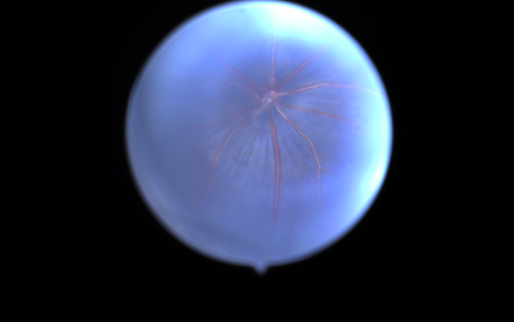
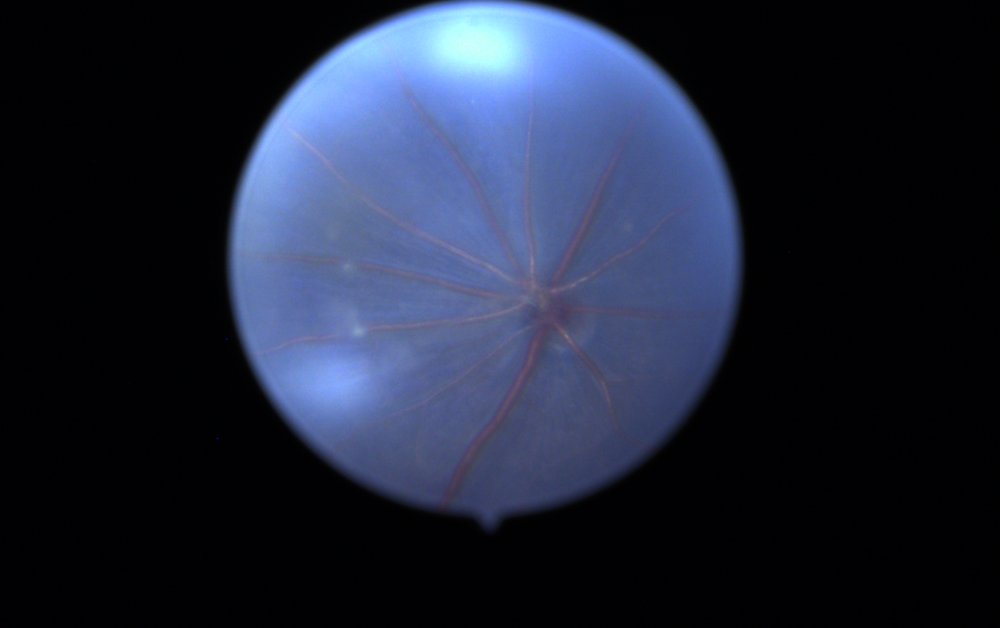

# RetinaSAGE

## Static-anchored quality-guided few-frame learning for retinal video classification

RetinaSAGE is a research framework for **retinal video classification under a limited observation budget**. 

The primary study is intentionally focused on three comparable systems:

- **B1** — frozen DINOv3 features from a fixed anchor frame;
- **B1 + final calibration** — B1 with the same inner-fold Platt calibration procedure;
- **B1 + constrained MIL-4 + final calibration** — B1 fused with a quality-guided four-frame MIL branch and calibrated on training-fold predictions.

The repository also retains B2–B9, P1–P3, residual/PCA, fixed-budget, public-dataset and engineering experiments. They are supplementary evidence rather than separate primary claims.

> **Research status.** This is experimental research code. It is not a clinically validated diagnostic system.

---

## 1. Study design

RetinaSAGE separates three sources of possible improvement:

1. the value of a fixed static anchor;
2. the value of probability calibration alone;
3. the value of adding a small, quality-guided set of observations.

All three primary methods share:

- frozen DINOv3 ViT-S/16 weights;
- identical preprocessing, ROI and input size;
- the same split manifest;
- five outer folds and four inner folds;
- training-only model selection, threshold selection and calibration.

### Representative OCTA frames

The following images illustrate the two classes used in the local OCTA stroke cohort. The first is a representative **stroke** image from `OCTAvideo/1103`; the second is a representative **healthy** image from `OCTAvideo/1028`. PNG derivatives are included for README rendering, while the original TIFF files are retained beside them.

| Class | Representative frame | Description |
|---|---|---|
| Stroke |  | Representative OCTA frame from the stroke cohort (`1103`). |
| Healthy |  | Representative OCTA frame from the healthy cohort (`1028`). |

Direct image links: [stroke image](./docs/assets/rvd_samples/stroke_1103_9hao_48h.png) · [healthy image](./docs/assets/rvd_samples/healthy_1028_h_right.png).

These images are documentation examples, not an additional evaluation set. Their labels and patient identifiers are not inferred from the README.

---

## 2. RetinaSAGE pipeline

**Pipeline summary**

1. Sample candidate frames from each retinal video.
2. Apply the shared preprocessing pipeline.
3. Extract frozen DINOv3 frame features.
4. Use the fixed anchor for B1, or select four quality-guided frames for MIL-4.
5. Fit the classifier or gated-attention MIL branch inside the training folds.
6. Fuse B1 and MIL-4 probabilities under the constrained weight rule.
7. Fit final Platt calibration using inner-fold out-of-fold predictions.
8. Evaluate once on the held-out outer fold.


### 2.1 Frozen representation

The main experiments use a frozen **DINOv3 ViT-S/16** image encoder. Frame features are cached through a feature-extraction manifest so that repeated classifier and aggregation experiments do not silently change the backbone or preprocessing.

### 2.2 B1: static anchor

B1 encodes one fixed reference frame and fits a low-capacity logistic-regression classifier. It is the main reference because it represents the minimum observation budget.

The anchor rule is fixed before comparison. It is not silently replaced by the highest-quality frame.

### 2.3 B1 + final calibration

This control uses the same B1 raw score and applies the final inner-fold Platt calibration procedure. It measures what calibration changes without adding new observations or a temporal aggregator.

A calibrated probability can improve Brier score and threshold behavior while leaving ranking metrics such as AUC unchanged in a single fold.

### 2.4 B1 + constrained MIL-4 + final calibration

For each video, four frames are selected using a label-free quality score with temporal coverage. Their frozen features are processed by a small gated-attention MIL classifier. The MIL score is fused with B1:

\[
p_{\mathrm{raw}}=(1-\lambda)p_{B1}+\lambda p_{MIL},
\qquad \lambda\in[0,0.5].
\]

The final Platt calibrator is fitted only on inner-fold out-of-fold predictions. Outer-test labels are reserved for evaluation.

---

## 3. Primary results

The following table is the **mean over five outer folds** from `runs/B1_B5/repro_three`. It is not a pooled out-of-fold estimate. Higher is better except for Brier score.

| Method | Probability | ROC-AUC ↑ | AP ↑ | Accuracy ↑ | Balanced accuracy ↑ | Brier ↓ |
|---|---|---:|---:|---:|---:|---:|
| **B1** | raw | 0.9733 | 0.9864 | 0.9846 | 0.9690 | 0.0319 |
| **B1 + final calibration** | calibrated | 0.9733 | 0.9864 | 0.9769 | 0.9548 | 0.0257 |
| **B1 + constrained MIL-4 + final calibration** | calibrated | **0.9783** | **0.9907** | **0.9923** | **0.9833** | **0.0176** |

Under this internal five-fold comparison, the calibrated MIL-4 branch is the strongest overall candidate. The result should be interpreted as evidence for a promising fixed-budget method, not as proof of external or clinical generalization.

### Probability and aggregation conventions

- `raw`: score before final Platt calibration;
- `calibrated`: score after inner-fold Platt calibration;
- `mean_outer`: average of metrics computed separately in each outer fold;
- `pooled_outer`: concatenate outer predictions and compute one metric.

These four views are stored separately in `metrics_four_views.csv` and must not be mixed.

---

## 4. Reproduction

```bash
python -m venv .venv
source .venv/bin/activate
python -m pip install --upgrade pip
python -m pip install -r requirements.txt
```

The exact commands used for the packaged runs are recorded in `runs/B1_B5/repro_three/delivery_manifest.json`. The command pattern is:

```bash
python train_b1.py \
  --config config_repro_three.yaml \
  --feature-manifest runs/P1/feature_extraction_manifest.csv \
  --split-manifest runs/B/split_manifest.csv \
  --device cuda

python train_b1_mil4_final_calibration.py \
  --b1-root runs/B1_B5/repro_three/b1 \
  --mil-root runs/B1_B5/quality_mil/mil_4 \
  --output runs/B1_B5/repro_three/b1_final_calibration_matched \
  --b1-only

python train_b1_mil4_final_calibration.py \
  --b1-root runs/B1_B5/repro_three/b1 \
  --mil-root runs/B1_B5/quality_mil/mil_4 \
  --output runs/B1_B5/repro_three/b1_mil4_final_calibration
```

Before reproducing, verify the DINOv3 checkpoint, feature-cache hash, feature-manifest hash, split-manifest hash, Python/PyTorch/CUDA versions, and outer-fold uniqueness checks.

---

## 5. Supplementary experiments

These experiments are retained to test alternative explanations and failure modes:

- **B2–B6:** pixel averaging, feature averaging, Deep Sets, recurrent and other temporal baselines;
- **P1–P3:** graph-temporal and future-prediction branches;
- **Quality-MIL:** MIL-1/2/4/8 and quality/uniform mean controls;
- **S1–S3:** residual, temporal and multiscale exploratory branches;
- **Residual/PCA:** exact-anchor residual, static temporal residual and PCA-local probes;
- **RVD:** public retinal video validation with official split and SVP task considerations;
- **ERODES:** auxiliary ocular-ultrasound clip-level validation;
- **CAMUS and other ultrasound data:** cross-task exploratory validation, not retinal external validation.

Historical negative results remain available. A supplementary branch is not promoted to the primary claim merely because it has a favorable point estimate.

---

## 6. Evaluation principles and limitations

1. Use identical outer folds for all compared methods.
2. Fit preprocessing, model selection, thresholds and calibration inside training folds.
3. Report animal-, patient- or clip-level denominators explicitly.
4. Keep raw/calibrated and mean_outer/pooled_outer results separate.
5. Report paired changes on the same evaluation units.
6. Do not treat frames, seeds or CV repeats as independent animals.
7. Treat RVD and ultrasound experiments as cross-task validation, not as independent MCAO validation.
8. Distinguish cached-feature timing from full acquisition-to-decision latency.

The primary study is limited by a small imbalanced cohort, one nested-CV repeat and limited independent validation. Quality selection is not assumed to be universally better than uniform selection; the controls are retained precisely to test that claim.

---

## 7. Data, privacy and license

The dataset, labels and pretrained weights are not redistributed by this repository. Review all images, manifests and Git history for private paths, identifiers, credentials and restricted files before publication. The two representative TIFF files in `docs/assets/rvd_samples/` are documentation examples copied from the local OCTA collection; redistribution must follow the governing data agreement.

Add an approved code license before redistribution. Dataset, checkpoint and third-party dependency licenses remain separate.

Copyright (c) 2025 Taotao9029. All rights reserved.
